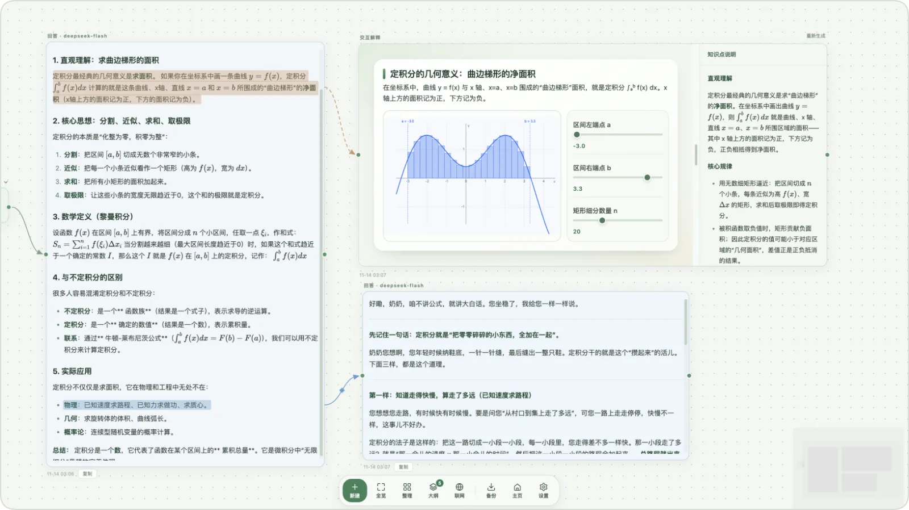

<h1 align="center">
  <picture>
    <source media="(prefers-color-scheme: dark)" srcset="assets/brand/resprout-wordmark-dark.png" />
    <source media="(prefers-color-scheme: light)" srcset="assets/brand/resprout-wordmark-light.png" />
    
  </picture>
</h1>

**Grow a question into a map of understanding that you can explore, revisit, and organize.**

[中文](README.md)

## What is Resprout?

Resprout is a node canvas for divergent learning. Start with a question, select an interesting or confusing passage, and turn each follow-up into a visible branch instead of squeezing every idea into one scrolling conversation.

Text answers, PDFs, images, and interactive explanations can all become nodes on the canvas, helping you organize scattered information into your own structure of understanding.

<p align="center">
  
</p>

## What problems does it solve?

- **Ideas branch, but linear chats hide those paths.** Each direction remains visible, and you can return to any earlier node to continue exploring.
- **Follow-ups lose context.** Questions stay connected to the selected passage, source material, and branch they came from.
- **Scattered answers are hard to organize.** Nodes, connections, and mainline management turn individual answers into a browsable map.
- **Abstract ideas can be difficult to grasp.** Interactive explanations use visuals, demonstrations, and controls to support exploration.

## How does it work?

1. Ask a question, or drop in a PDF or image as learning material.
2. Select a passage worth exploring and grow a new branch from it.
3. Compare directions, revisit earlier nodes, and organize mainlines and side branches.
4. Keep sessions locally and back them up or restore them as JSON.

When you need current information, enable web search and page fetching to incorporate linked online sources into answers.

Resprout uses your configured model provider and API key. No Resprout account or cloud synchronization is required.

## Install and use

You need **Node.js 22.19 or newer**.

Run directly without installing:

```bash
npx --yes resprout
```

Or install the command globally:

```bash
npm install -g resprout
resprout
```

The app opens at **http://127.0.0.1:4173** automatically. On first use, open the model settings, choose DeepSeek or an OpenAI-compatible provider, enter your API key, and select a model to start asking questions.

Enable web search when you want online information. This feature is provided by DeepSeek and can reuse a DeepSeek API key you have already configured.

## Acknowledgments

The node canvas is built with [React Flow](https://reactflow.dev/), [source code](https://github.com/wbkd/react-flow), copyright webkid GmbH (2019–2025), licensed under the [MIT License](https://github.com/wbkd/react-flow/blob/main/LICENSE).

Model access, tool calls, and streaming responses use [pi-ai](https://github.com/earendil-works/pi/tree/main/packages/ai). Ordinary text answers use [pi-durable](https://github.com/earendil-works/pi/tree/main/packages/durable) for durable execution. Both are licensed under [MIT](https://github.com/earendil-works/pi/blob/main/LICENSE). Resprout is an independent project and is not affiliated with or endorsed by Earendil Works.

## License

MIT. See [LICENSE](LICENSE). Third-party dependencies retain their respective licenses.
