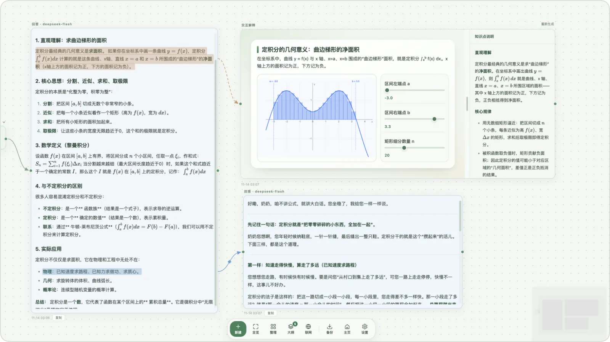

<h1 align="center">
  <picture>
    <source media="(prefers-color-scheme: dark)" srcset="assets/brand/resprout-wordmark-dark.png" />
    <source media="(prefers-color-scheme: light)" srcset="assets/brand/resprout-wordmark-light.png" />
    
  </picture>
</h1>

**让一个问题生长为一张可以探索、回溯和整理的理解地图。**

[English](README.en.md)

## Resprout 是什么？

Resprout 是一个用于发散式学习的节点画布。你可以从一个问题出发，选中感兴趣或没看懂的内容继续追问，把每一次探索保留为独立分支，而不是让所有想法挤在一条不断滚动的聊天记录里。

文字回答、PDF、图片和交互解释都可以成为画布上的节点，帮助你把零散的信息逐渐整理成自己的理解结构。

<p align="center">
  
</p>

## 它解决什么问题？

- **想法分叉后难以保留**：每个分支都独立存在，可以随时回到之前的节点继续探索。
- **线性聊天容易丢失上下文**：追问与选中内容、来源资料和对应分支保持关联。
- **学习内容难以形成整体结构**：通过节点、连线和主线管理，把零散回答组织成可浏览的理解地图。
- **抽象内容不易理解**：可以围绕当前内容生成交互解释，用图形、演示和操作辅助理解。

## 它如何工作？

1. 输入一个问题，或拖入 PDF、图片作为学习资料。
2. 从回答中选中值得追问的内容，生长出新的分支。
3. 比较不同方向，回到早期节点，或整理主线与侧枝。
4. 将会话保存在本地，并通过 JSON 备份和恢复。

需要最新信息时，可以开启联网搜索与网页读取，让回答结合带来源链接的网络内容。

Resprout 使用你配置的模型供应商与 API Key，不需要 Resprout 账号或云端同步。

## 安装与使用

需要 **Node.js 22.19 或更高版本**。

无需安装，直接运行：

```bash
npx --yes resprout@alpha
```

或者全局安装命令：

```bash
npm install -g resprout@alpha
resprout
```

启动后会自动打开 **http://127.0.0.1:4173**。首次使用时，在“模型设置”中选择 DeepSeek 或 OpenAI 兼容供应商，填写 API Key 并选择模型，即可开始提问。

需要联网获取信息时，打开“联网搜索”。该功能由 DeepSeek 提供，可复用已配置的 DeepSeek API Key。

## 开发与测试

```bash
npm run typecheck     # TypeScript 类型检查
npm run build         # 生产构建
npm run test:unit     # 纯逻辑单元测试
npm run test:browser  # 真实浏览器固定 fixture + store 集成测试
npm test              # 全部离线测试（不依赖模型/API 密钥）
```

`test:browser` 需要本机安装 Chromium 内核浏览器，默认优先使用 Microsoft Edge；可用
`RESPROUT_BROWSER=/path/to/chrome` 指定。固定样本结果记录在
`tests/browser/baseline.json`，`npm run test:baseline` 只比较状态与问题码。
生成的诊断包可用 `node tests/browser/run.ts --replay=/path/to/diagnostic.json` 重放验收。
交互流水线的修复设计与验证说明见
[`docs/interactive-pipeline-repair-report.md`](docs/interactive-pipeline-repair-report.md)。

## 致谢

节点画布使用 [React Flow](https://reactflow.dev/)，[源码](https://github.com/wbkd/react-flow)，版权所有 webkid GmbH（2019–2025），采用 [MIT 协议](https://github.com/wbkd/react-flow/blob/main/LICENSE)。

模型接入、工具调用和流式回答使用 [pi-ai](https://github.com/earendil-works/pi/tree/main/packages/ai)，普通文本的持久执行使用 [pi-durable](https://github.com/earendil-works/pi/tree/main/packages/durable)，均采用 [MIT 协议](https://github.com/earendil-works/pi/blob/main/LICENSE)。Resprout 是独立项目，并非 Earendil Works 官方产品或受其背书的项目。

## 开源协议

MIT，详见 [LICENSE](LICENSE)。第三方依赖保留各自的开源协议。
